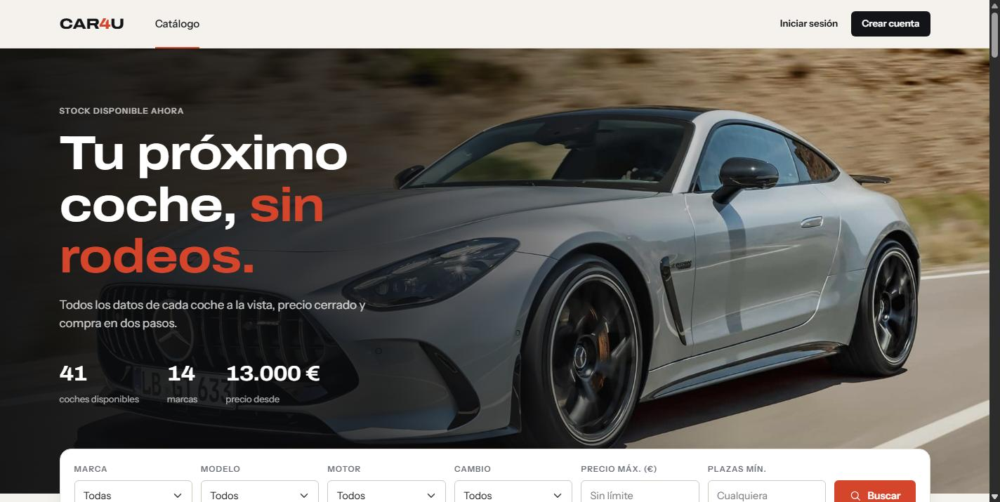
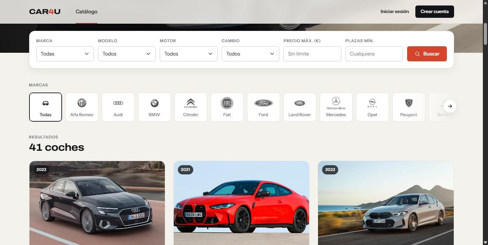
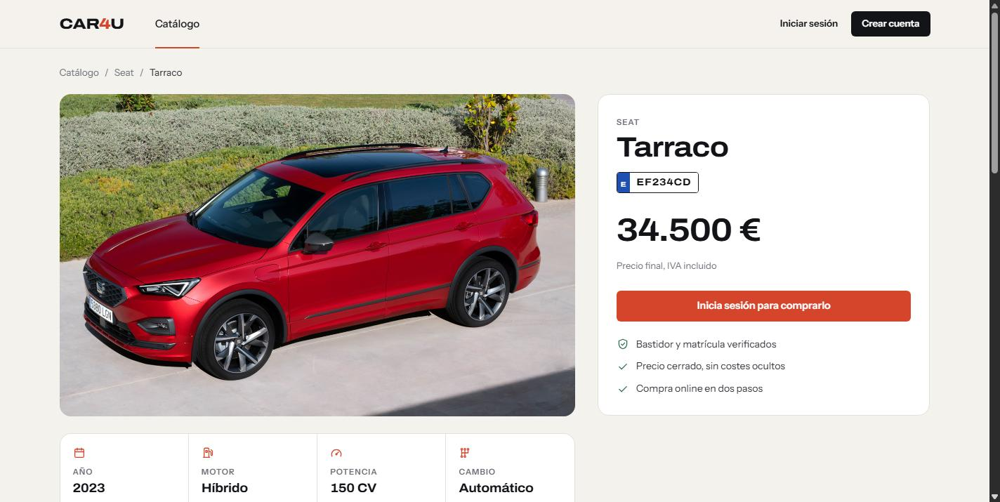
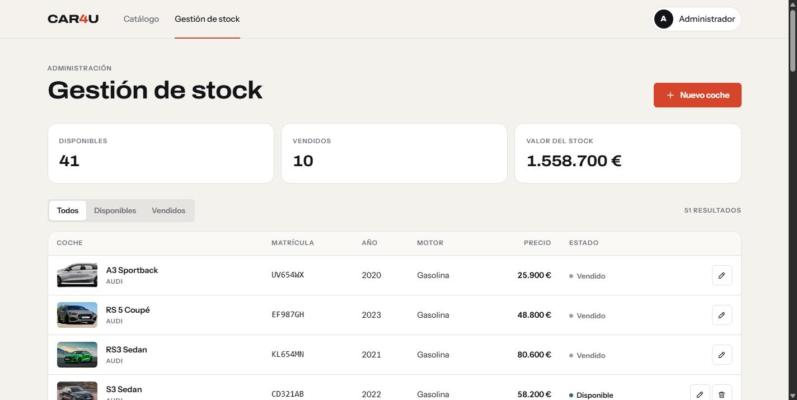

# Car4U · Concesionario web

Aplicación web de un concesionario de coches: catálogo con filtros, ficha detallada de cada coche,
favoritos, compra online y panel de gestión del stock para el administrador.

Es la evolución de mi Trabajo de Fin de Grado (una aplicación de escritorio en Java Swing), rehecha
como **aplicación web empresarial en Java**: Spring Boot, Struts 2, JSP, JDBC y MySQL, desplegable en Apache Tomcat.


-0b5394)




| Catálogo con filtros | Ficha del coche |
|---|---|
|  |  |

| Panel de administración |
|---|
|  |

---

## Índice

- [Funcionalidades](#funcionalidades)
- [Tecnologías](#tecnologías)
- [Arquitectura](#arquitectura)
- [Cómo probarlo en local](#cómo-probarlo-en-local)
- [Usuarios de prueba](#usuarios-de-prueba)
- [API REST](#api-rest)
- [Tests](#tests)
- [Estructura del proyecto](#estructura-del-proyecto)
- [Decisiones técnicas](#decisiones-técnicas)
- [Diseño](#diseño)
- [Próximos pasos](#próximos-pasos)

---

## Funcionalidades

**Visitante**
- Catálogo de coches disponibles con filtros por marca, modelo, motor, cambio, precio máximo y plazas.
- Filtro rápido por marca con una franja de logos.
- Ficha de cada coche: fotos, precio, especificaciones y coches relacionados de la misma marca.
- Registro de cuenta con validación de cada campo.

**Cliente**
- Guardar y quitar favoritos.
- Comprar un coche con pantalla de confirmación. La compra es atómica, y si dos clientes compran el mismo coche a la vez solo uno lo consigue.
- Historial de compras con importe total.

**Administrador**
- Panel con cifras del stock: disponibles, vendidos y valor total.
- Listado de coches con filtro por estado.
- Alta, edición y borrado de coches, con validación y vista previa de la foto del modelo. No se pueden borrar coches vendidos.

**Integraciones**
- API REST de solo lectura en JSON (`/api/coches`, `/api/marcas`).

## Tecnologías

| Capa | Tecnología | Para qué se usa |
|---|---|---|
| Lenguaje | **Java 21** | Records, text blocks, `switch` con flechas, pattern matching |
| Framework | **Spring Boot 3.5** | Arranque, configuración e inyección de dependencias |
| Capa web (MVC) | **Apache Struts 2** (7.4) | Actions, interceptores, validación y tags en las vistas |
| Vistas | **JSP + JSTL** | HTML generado en el servidor |
| API | **Spring MVC** (`@RestController`) | Endpoints REST en JSON |
| Seguridad | **Spring Security** | Login, roles, contraseñas con BCrypt, protección CSRF |
| Acceso a datos | **JDBC** con `NamedParameterJdbcTemplate` + **HikariCP** | SQL con parámetros sobre un pool de conexiones |
| Base de datos | **MySQL / MariaDB** | Datos de la aplicación |
| Migraciones | **Flyway** | Esquema y datos iniciales versionados |
| Servidor | **Apache Tomcat 10.1** | Embebido en desarrollo; el WAR también se despliega en un Tomcat externo |
| Build | **Maven** (incluye Maven Wrapper) | Dependencias, compilación, tests y empaquetado |
| Tests | **JUnit 5, Mockito, MockMvc, H2** | Tests unitarios, de repositorio, de API y de integración |
| Front | CSS propio sobre la rejilla de **Bootstrap 5**, iconos SVG, JavaScript sin librerías | Diseño y pequeñas interacciones |

## Arquitectura

Es una aplicación **MVC con renderizado en el servidor**, organizada en capas:

```
Navegador
   │
   ▼
Spring Security ───────── autenticación, roles CLIENTE/ADMIN, CSRF
   │
   ├──► Filtro de Struts 2 ──► Actions ──► JSP              (pantallas)
   │
   └──► Spring MVC ──► @RestController ──► JSON             (/api/**)
                 │
                 ▼
        Servicios  (@Service, @Transactional)     lógica de negocio y transacciones
                 │
                 ▼
        Repositorios (@Repository, JdbcTemplate)  SQL con parámetros (PreparedStatement)
                 │
                 ▼
        MySQL / MariaDB  ←── esquema versionado con Flyway
```

- **Struts 2 + Spring:** las Actions de Struts las crea Spring (`struts2-spring-plugin`), que les inyecta
  los servicios por constructor. Struts se encarga de la parte web (URLs, parámetros, validación, vistas)
  y Spring de todo lo demás.
- **Una sola capa de negocio:** las pantallas de Struts y la API REST usan los mismos servicios.
- **Recorrido de una petición**, por ejemplo `GET /catalogo?marca=Seat`:
  Spring Security → `CatalogoAction` → `CocheServicio` → `CocheRepositorio` → MySQL → `catalogo.jsp` → HTML.

## Cómo probarlo en local

### Requisitos

- **JDK 21**
- **MySQL 8** o **MariaDB 10.4+**. Por ejemplo, el MySQL de [XAMPP](https://www.apachefriends.org/).
- Git. Maven no hace falta, porque el proyecto incluye el Maven Wrapper (`mvnw`).

### 1. Clonar el repositorio

```bash
git clone https://github.com/sebasbbck/concesionario-web.git
cd concesionario-web
```

### 2. Crear la base de datos

Con MySQL arrancado, crea la base de datos vacía (desde phpMyAdmin, MySQL Workbench o la consola):

```sql
CREATE DATABASE concesionario CHARACTER SET utf8mb4 COLLATE utf8mb4_unicode_ci;
```

No hace falta crear tablas: **Flyway las crea y carga los datos de ejemplo** la primera vez que arranca
la aplicación (51 coches de 14 marcas, con sus fotos).

Por defecto conecta a `localhost:3306` con el usuario `root` sin contraseña, como en XAMPP.
Si tu MySQL tiene otro usuario o contraseña, usa variables de entorno:

| Variable | Valor por defecto |
|---|---|
| `DB_URL` | `jdbc:mysql://localhost:3306/concesionario?...` |
| `DB_USER` | `root` |
| `DB_PASSWORD` | *(vacía)* |

```bash
# Linux / macOS
export DB_USER=miusuario DB_PASSWORD=micontraseña
# Windows (PowerShell)
$env:DB_USER="miusuario"; $env:DB_PASSWORD="micontraseña"
```

### 3. Arrancar la aplicación

```bash
# Linux / macOS
./mvnw spring-boot:run

# Windows
mvnw.cmd spring-boot:run
```

Abre **http://localhost:8080**.

**Desde un IDE:**
- **NetBeans:** *File → Open Project* y *Run* (F6). El fichero `nbactions.xml` ya configura `spring-boot:run`.
- **IntelliJ IDEA / Eclipse / VS Code:** abre la carpeta como proyecto Maven y ejecuta la clase
  `com.sebas.concesionario.ConcesionarioApplication`.

### Opcional: desplegar el WAR en un Tomcat externo

```bash
./mvnw clean package          # genera target/concesionario.war
```

- **Ejecutarlo directamente:** `java -jar target/concesionario.war` (con el Tomcat embebido).
- **En un Tomcat 10.1 instalado:** copia el WAR a `webapps/`. Las fotos se leen de la carpeta
  `datos/fotos` relativa al directorio de trabajo; con la variable `FOTOS_DIR` puedes indicar una ruta absoluta.

## Usuarios de prueba

| Usuario | Contraseña | Rol | Qué puede hacer |
|---|---|---|---|
| `cliente` | `cliente1234` | Cliente | Favoritos, comprar, ver sus compras |
| `admin` | `admin1234` | Administrador | Gestionar el stock de coches |

También puedes crear un cliente nuevo desde **Crear cuenta**.

## API REST

Endpoints públicos de solo lectura, en JSON:

| Método | Ruta | Descripción |
|---|---|---|
| `GET` | `/api/coches` | Coches disponibles. Filtros opcionales: `marca`, `motor` (`GASOLINA`, `DIESEL`, `HIBRIDO`, `ELECTRICO`), `cambio` (`MANUAL`, `AUTOMATICO`), `precioMax`, `plazasMin`, `estado` |
| `GET` | `/api/coches/{bastidor}` | Un coche por su número de bastidor |
| `GET` | `/api/marcas` | Marcas disponibles |

```bash
curl "http://localhost:8080/api/coches?marca=Seat&motor=HIBRIDO"
```

Respuesta (extracto; cada coche incluye también color, cilindrada, puertas y plazas):

```json
[
  {
    "bastidor": "SAJWA0ES7DP567890",
    "matricula": "EF234CD",
    "marca": "Seat",
    "modelo": "Tarraco",
    "fechaFabricacion": "2023-01-20",
    "motor": "HIBRIDO",
    "potenciaCv": 150,
    "cambio": "AUTOMATICO",
    "precio": 34500.00,
    "estado": "DISPONIBLE",
    "foto": "/fotos/coches/seat-tarraco.jpg"
  }
]
```

Los errores devuelven `ProblemDetail` (RFC 9457): 404 si el coche no existe y 400 si un parámetro no es válido.

## Tests

```bash
./mvnw test
```

Los tests usan **H2 en memoria en modo MySQL** con las mismas migraciones de Flyway, así que no necesitan MySQL instalado.

| Test | Tipo | Qué comprueba |
|---|---|---|
| `CocheRepositorioTest` | Repositorio (`@JdbcTest`) | Consultas JDBC reales: filtros, que un valor malicioso no provoque inyección SQL, que un coche no se pueda marcar como vendido dos veces |
| `UsuarioRepositorioTest` | Repositorio | Inserción con id autogenerado |
| `CompraServicioTest` | Unitario (Mockito) | Reglas de la compra sin base de datos |
| `CocheRestControllerTest` | Web (`@WebMvcTest` + MockMvc) | Respuestas JSON, 404 y 400 de la API |
| `AplicacionIntegracionTest` | Integración (`@SpringBootTest`) | La aplicación completa en un Tomcat embebido: Struts, JSP, seguridad y CSRF |

## Estructura del proyecto

```
concesionario-web/
├── pom.xml
├── mvnw, mvnw.cmd, .mvn/            Maven Wrapper
├── datos/fotos/                      fotos de coches, marcas y perfiles (servidas en /fotos/**)
├── docs/capturas/                    capturas de este README
└── src/
    ├── main/
    │   ├── java/com/sebas/concesionario/
    │   │   ├── ConcesionarioApplication.java
    │   │   ├── config/               Struts (filtro), Spring MVC y Spring Security
    │   │   ├── modelo/               Coche, Usuario, Compra, enums (TipoMotor, TipoCambio...)
    │   │   ├── repositorio/          acceso a datos con JDBC
    │   │   ├── servicio/             lógica de negocio y transacciones
    │   │   ├── seguridad/            UserDetailsService y usuario actual
    │   │   └── web/
    │   │       ├── struts/           Actions de Struts 2 e interceptor propio
    │   │       └── api/              API REST (Spring MVC)
    │   ├── resources/
    │   │   ├── application.properties
    │   │   ├── struts.xml            URL → Action → resultado (JSP o redirección)
    │   │   ├── db/migration/         V1__esquema.sql, V2__datos_iniciales.sql (Flyway)
    │   │   └── static/               CSS e imágenes
    │   └── webapp/WEB-INF/jsp/       vistas JSP
    └── test/                         tests JUnit 5
```

## Decisiones técnicas

**Acceso a datos**
- **Todo el SQL lleva parámetros** (`:marca` → `PreparedStatement`). No se concatena ningún valor, así que no hay inyección SQL.
  Incluso la búsqueda con filtros dinámicos solo concatena fragmentos fijos de SQL.
- **`JdbcTemplate` sobre un pool HikariCP:** las conexiones se reutilizan y se cierran solas, igual que los statements y los `ResultSet`.
- **Esquema normalizado** con claves foráneas, `UNIQUE` y `CHECK`. El coche apunta al modelo y el modelo a la marca, sin datos duplicados.

**Lógica de negocio**
- **Compra transaccional (`@Transactional`):** marcar el coche como vendido y registrar la compra se hacen las dos o ninguna.
- **Control de concurrencia:** `UPDATE coches SET estado='COMPRADO' WHERE bastidor=? AND estado='DISPONIBLE'`.
  Si dos clientes compran a la vez, solo una actualización afecta a la fila.
- **Errores de negocio como excepciones propias** (`NegocioException`, `NoEncontradoException`), que cada capa web traduce a su formato:
  un mensaje en pantalla o un `ProblemDetail` en la API.

**Seguridad**
- Contraseñas con **BCrypt**, roles `CLIENTE` y `ADMIN`, y rutas protegidas en `SecurityConfig`.
- **CSRF** en todos los formularios POST.
- **Interceptor propio de Struts** (`SoloPostInterceptor`): las acciones que cambian datos solo aceptan POST.
- Medidas de **Struts 7**:
  - los parámetros de la petición solo se asignan a setters anotados con `@StrutsParameter`;
  - OGNL solo accede a los paquetes permitidos (`struts.allowlist.packageNames`).
- Patrón **Post/Redirect/Get**: tras un POST se redirige, y los mensajes llegan a la página siguiente gracias al interceptor `store`.

## Diseño

La interfaz tiene un diseño propio en lugar del aspecto por defecto de Bootstrap:

- **Sistema de diseño con variables CSS:** tinta casi negra sobre fondo papel y un único acento rojo.
- **Tipografías:** Archivo (ancha, para titulares) e Instrument Sans (texto).
- **Iconos SVG propios** en un sprite.
- **Composición:** portada con cifras reales del stock, buscador superpuesto y carrusel de logos de marcas.
- **Ficha:** panel de compra fijo al hacer scroll.
- **Responsive** y con foco visible para navegar con teclado.

Todo el estilo está en [`src/main/resources/static/css/app.css`](src/main/resources/static/css/app.css).

## Próximos pasos

- [ ] Gestión de marcas, modelos y usuarios desde el panel de administración
- [ ] Subida de fotos al dar de alta un modelo
- [ ] Informe PDF del catálogo con JasperReports (como en la versión de escritorio)
- [ ] Recuperación de contraseña por correo
- [ ] Docker Compose (aplicación + MySQL) e integración continua con GitHub Actions

## Autor

**Sebastián Coello Sinche** · [GitHub](https://github.com/sebasbbck) · [LinkedIn](https://linkedin.com/in/sebastian-coello-sinche)

Proyecto de portfolio. Los datos son de demostración y las imágenes de los coches y los logos pertenecen
a sus respectivos fabricantes; se usan solo con fines educativos.
